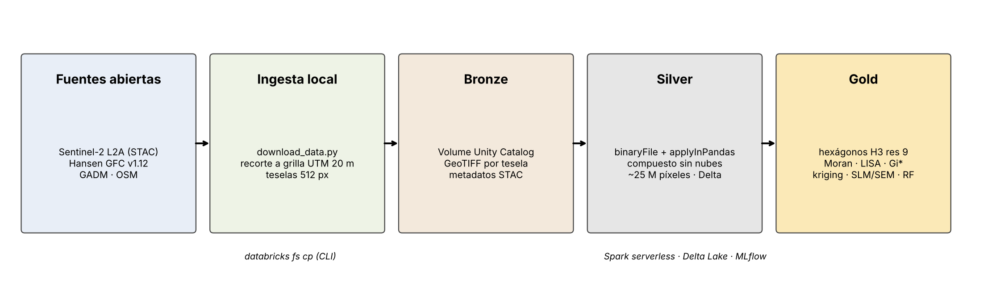
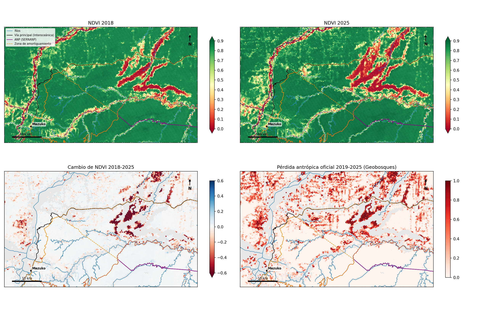
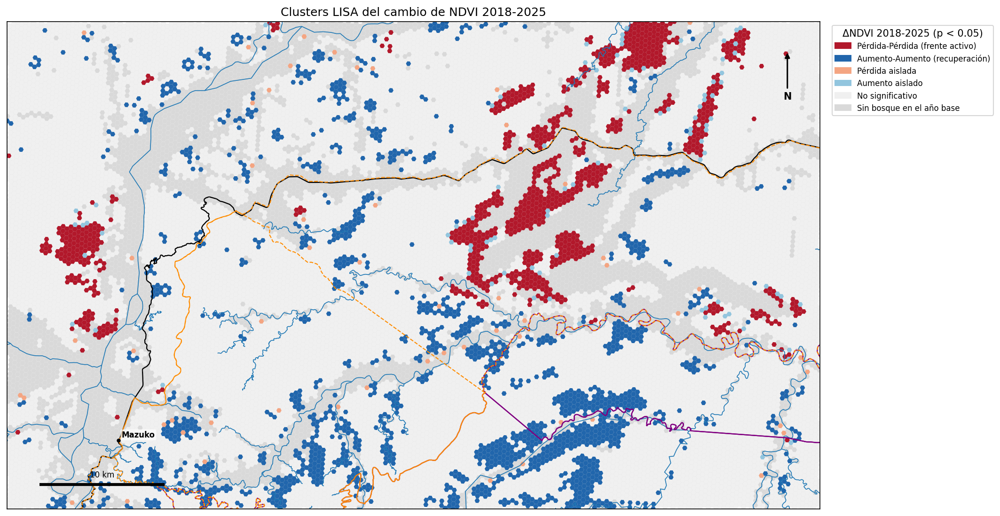
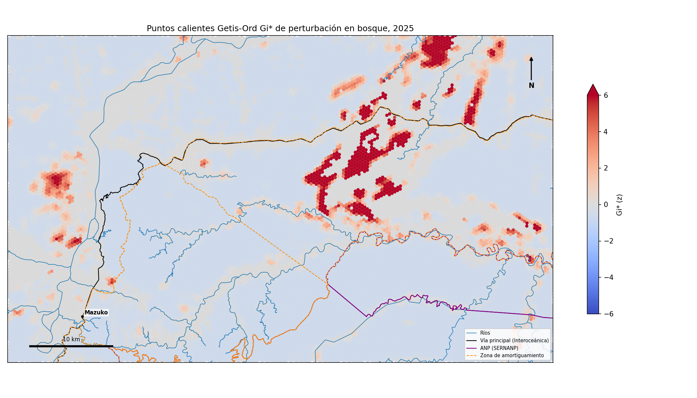
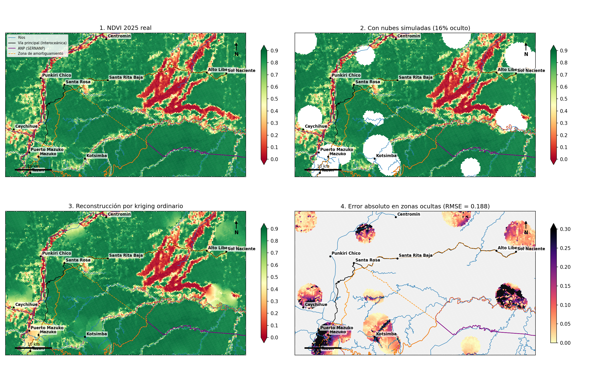
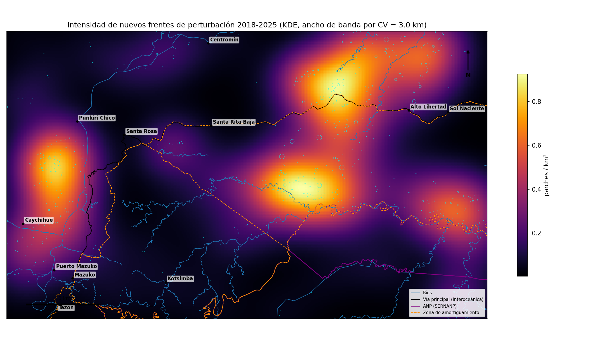
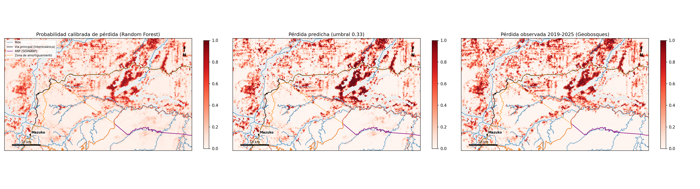

# Teledetección a gran escala en la nube: minería aurífera y deforestación en Madre de Dios

Pipeline Big Data en **Databricks** (Spark + Delta Lake + Unity Catalog + H3) que procesa imágenes
**Sentinel-2** para cuantificar la pérdida de bosque asociada a la minería aluvial en el corredor
**La Pampa, Huepetuhe y Mazuko** (Madre de Dios, Perú), y la analiza con estadística espacial,
geoestadística y Machine Learning.



## Pregunta

¿Dónde y con qué patrón espacial avanzó la pérdida de vegetación entre 2018 y 2024 en el
principal frente de minería ilegal de la Amazonía peruana, y qué factores geográficos la explican?

## Área y datos

| Elemento | Detalle |
|---|---|
| Área de estudio | 65 × 39 km (≈ 2 500 km²), UTM 19S, entre −70.45° y −69.85° de longitud y −13.15° y −12.80° de latitud |
| Grilla | 3 250 × 1 950 píxeles de 20 m (6.3 M píxeles por banda), 28 teselas de 512 px |
| Periodo | Temporada seca (julio-setiembre) de 2018, 2020, 2022, 2024 y 2025 |

| Fuente | Uso | Ingreso a la nube |
|---|---|---|
| Sentinel-2 L2A (ESA Copernicus), vía Earth Search / AWS Open Data | Bandas B2, B3, B4, B8, B11, B12 y máscara SCL | cloud-to-cloud desde Databricks (COG, solo bloques del área) |
| Hansen Global Forest Change v1.12 (UMD) | Pérdida 2001-2024 y cobertura 2000: comparación internacional | cloud-to-cloud desde Google Cloud Storage |
| Geobosques (MINAM, PNCBMCC) | Pérdida oficial 2001-2025 (antrópica vs natural en 2025), bosque 2025, riesgo de deforestación | landing (zip oficial) |
| SERNANP | ANP de administración nacional definitivas y zonas de amortiguamiento | landing (shapefile oficial) |
| GADM 4.1 | Distritos de Madre de Dios | landing |
| OpenStreetMap (Geofabrik) | Carretera Interoceánica y ríos | landing |

## Arquitectura (medallion sobre Unity Catalog)

```
Instituciones (SERNANP, MINAM, GADM, OSM) ──► data/landing ──databricks fs cp──┐
                                                                               ▼
                                   Volume  /Volumes/workspace/madre_dios_rs/raw/landing
AWS Open Data (Sentinel-2) ─┐                                                  │ notebook 00 (en la nube)
Google Cloud (Hansen)  ─────┴── lectura COG por rangos ──────────────────────► │
  BRONZE  teselas GeoTIFF alineadas (UTM 19S, 20 m), vectores recortados, metadatos STAC
     │    binaryFile + groupBy(year, tile).applyInPandas
  SILVER  silver_s2_pixeles (≈30 M filas), silver_geobosques_pixeles, silver_hansen_pixeles
     │    h3_longlatash3string + agregaciones SQL
  GOLD    gold_h3_anual, gold_h3_features, gold_h3_ndvi_kriging, gold_pred_perdida_pixel
```

## Notebooks

| # | Notebook | Contenido |
|---|---|---|
| 00 | `00_ingesta_cloud_bronze` | Landing → Bronze en la nube: fuentes oficiales, descarga satelital cloud-to-cloud, inventario distribuido, control de calidad |
| 01 | `01_silver_compuestos_spark` | Compuesto por mediana sin nubes e índices espectrales (NDVI, NBR, NDWI, MNDWI, BSI) distribuidos por teselas |
| 02 | `02_gold_h3_y_aede` | Agregación a hexágonos H3, covariables geográficas, exportación del dataset limpio, AEDE |
| 03 | `03_dependencia_espacial` | Matriz W sobre H3, I de Moran, C de Geary, LISA, Getis-Ord Gi* (esda y Spark SQL escalable) |
| 04 | `04_variograma_y_kriging` | Variograma empírico, modelos teóricos, anisotropía, kriging ordinario vs IDW, relleno de vacíos por nubes |
| 05 | `05_patrones_puntuales` | KDE, funciones G y L de Ripley con envolventes, Clark-Evans, dependencia de la distancia al río |
| 06 | `06_regresion_espacial_y_ml` | MCO, SLM y SEM con tests LM; Random Forest con validación por bloques espaciales y puntuación distribuida |

## Resultados (ejecución en Databricks serverless)

Los notebooks de `notebooks/` contienen el código; las versiones **ejecutadas, con todas sus tablas, mapas y
gráficos**, están en `resultados/`. Los archivos HTML se descargan y se abren en cualquier navegador.

| # | Código | Ejecutado (GitHub) | HTML |
|---|---|---|---|
| 00 | [código](notebooks/00_ingesta_cloud_bronze.ipynb) | [ejecutado](resultados/notebooks_ejecutados/00_ingesta_cloud_bronze.ipynb) | [HTML](resultados/html/00_ingesta_cloud_bronze.html) |
| 01 | [código](notebooks/01_silver_compuestos_spark.ipynb) | [ejecutado](resultados/notebooks_ejecutados/01_silver_compuestos_spark.ipynb) | [HTML](resultados/html/01_silver_compuestos_spark.html) |
| 02 | [código](notebooks/02_gold_h3_y_aede.ipynb) | [ejecutado](resultados/notebooks_ejecutados/02_gold_h3_y_aede.ipynb) | [HTML](resultados/html/02_gold_h3_y_aede.html) |
| 03 | [código](notebooks/03_dependencia_espacial.ipynb) | [ejecutado](resultados/notebooks_ejecutados/03_dependencia_espacial.ipynb) | [HTML](resultados/html/03_dependencia_espacial.html) |
| 04 | [código](notebooks/04_variograma_y_kriging.ipynb) | [ejecutado](resultados/notebooks_ejecutados/04_variograma_y_kriging.ipynb) | [HTML](resultados/html/04_variograma_y_kriging.html) |
| 05 | [código](notebooks/05_patrones_puntuales.ipynb) | [ejecutado](resultados/notebooks_ejecutados/05_patrones_puntuales.ipynb) | [HTML](resultados/html/05_patrones_puntuales.html) |
| 06 | [código](notebooks/06_regresion_espacial_y_ml.ipynb) | [ejecutado](resultados/notebooks_ejecutados/06_regresion_espacial_y_ml.ipynb) | [HTML](resultados/html/06_regresion_espacial_y_ml.html) |

| Cambio de NDVI y pérdida oficial | Clusters LISA |
|---|---|
|  |  |
| **Puntos calientes Gi\*** | **Kriging para vacíos por nubes** |
|  |  |
| **Intensidad de nuevos frentes (KDE)** | **Modelo vs pérdida oficial** |
|  |  |

## Cómo reproducirlo

### 1. Zona landing (archivos oficiales)

Descargar de cada portal y dejar en `data/landing/` sin descomprimir:

```
data/landing/
├── sernanp/        ANP Nacional Definitivas.zip, Zonas de Amortiguamiento.zip   (geo.sernanp.gob.pe)
├── geobosques/     Perdida_2001_2025_Raster.zip, Bosque_NoBosque_Perdida_2001_2025_Raster.zip,
│                   Mapa de Riesgo de Deforestacion.zip, *.xlsx                  (geobosques.minam.gob.pe)
├── gadm/           gadm41_PER_3.json.zip                                        (gadm.org)
└── osm_geofabrik/  peru-latest-free.shp.zip                                     (download.geofabrik.de)
```

### 2. Subir a Databricks con la CLI

```powershell
winget install Databricks.DatabricksCLI
.\scripts\databricks_setup.ps1 -WorkspaceUrl "https://<workspace>.cloud.databricks.com" `
    -RepoUrl "https://github.com/wilder14-eslu/teledeteccion-cloud-madre-de-dios"
```

Autentica con OAuth, crea el esquema y el Volume, sube `data/landing` y crea un *Git folder* con este repositorio.

### 3. Ejecutar en la nube

Abrir los notebooks en Databricks y ejecutarlos en orden (00 a 06) sobre cómputo serverless. El notebook 00
descarga Sentinel-2 y Hansen directamente desde AWS y Google Cloud.

### 4. Orquestación como código (Databricks Asset Bundle)

```powershell
databricks bundle validate -p mdd
databricks bundle deploy   -p mdd
databricks bundle run pipeline_teledeteccion -p mdd
```

`databricks.yml` define un Job serverless con el DAG `00 → 01 → 02 → {03, 04, 05, 06}`: los cuatro análisis
corren en paralelo sobre la capa Gold. Incluye reintento en la ingesta y una programación mensual (en pausa en modo
desarrollo).

### 5. Publicar los resultados

```powershell
.\scripts\exportar_resultados.ps1
```

Exporta los notebooks ejecutados (con salidas) y las figuras para versionarlos en GitHub.

**Plan B (workspace sin salida a internet):**

```powershell
pip install -r requirements.txt
python scripts\check_availability.py
python scripts\download_data.py
.\scripts\databricks_setup.ps1 -WorkspaceUrl "..." -SubirBronze
```

## Estructura

```
├── notebooks/            00 a 06 (Databricks, PySpark): código
├── resultados/           notebooks ejecutados (.ipynb con salidas) y HTML
├── src/geocloud/         config, procesamiento raster, utilidades espaciales, compatibilidad Databricks/local
├── scripts/              despliegue y exportación con Databricks CLI, descarga local de respaldo
├── databricks.yml        Job del pipeline (Databricks Asset Bundle)
├── docs/                 arquitectura, guion de la demostración y figuras/
└── data/                 (ignorado por git) landing/ con las fuentes oficiales
```

## Notas técnicas

- **Nubes:** se usa la Scene Classification Layer (SCL) para enmascarar píxel a píxel y un compuesto por
  mediana por temporada; los hexágonos sin observación válida se rellenan por kriging.
- **Reflectancia:** se aplica escala y offset de cada escena (cambio de *processing baseline* 04.00 en 2022)
  para que los índices sean comparables entre años.
- **Control radiométrico:** la colección antigua de Earth Search ya trae aplicado el offset del baseline 04.00;
  se detecta por metadatos y por la fracción de reflectancias negativas, y el notebook 01 detiene el pipeline si el
  NDVI sale de [-1, 1].
- **Máscara de bosque:** perturbación y pérdida se miden solo sobre el bosque del año base (Geobosques), para que
  cauces, playas y zonas sin bosque no se confundan con minería; las tasas se expresan sobre el bosque disponible.
- **Kriging por oclusión:** como el compuesto anual no deja vacíos, se simulan nubes (15 % del área) y se evalúa la
  reconstrucción contra el valor real, con cobertura del intervalo de kriging.
- **Patrones puntuales:** los eventos son parches reales de perturbación (componentes conexos ≥ 1 ha) y las
  envolventes se generan bajo CSR condicionado al bosque disponible.
- **Calibración del modelo:** las probabilidades se corrigen a la prevalencia real; la superficie de pérdida se estima
  con la suma de probabilidades calibradas y la detección píxel a píxel con el umbral que maximiza F1.
- **Validación espacial:** los modelos de ML se evalúan con validación cruzada por bloques H3 de resolución 6
  para no sobreestimar el desempeño por autocorrelación espacial.
- **Pérdida natural vs antrópica:** Geobosques separa en 2025 la pérdida natural (migración de ríos), que se excluye
  de la etiqueta del modelo para no confundirla con minería.
- **Databricks Free Edition:** solo cómputo serverless; la salida a internet se habilita verificando la cuenta con
  LinkedIn. Sin ella se usa el plan B.

## Referencias

- Anselin, L. (1995). Local indicators of spatial association: LISA. *Geographical Analysis, 27*(2), 93-115.
- Caballero Espejo, J., Messinger, M., Román-Dañobeytia, F., Ascorra, C., Fernandez, L. E., & Silman, M. (2018). Deforestation and forest degradation due to gold mining in the Peruvian Amazon: A 34-year perspective. *Remote Sensing, 10*(12), 1903.
- Drusch, M., et al. (2012). Sentinel-2: ESA's optical high-resolution mission for GMES operational services. *Remote Sensing of Environment, 120*, 25-36.
- Getis, A., & Ord, J. K. (1992). The analysis of spatial association by use of distance statistics. *Geographical Analysis, 24*(3), 189-206.
- Gorelick, N., et al. (2017). Google Earth Engine: Planetary-scale geospatial analysis for everyone. *Remote Sensing of Environment, 202*, 18-27.
- Ministerio del Ambiente. (2025). *Cobertura y pérdida de bosque húmedo amazónico 2001-2025* [Conjunto de datos]. Geobosques, Programa Nacional de Conservación de Bosques para la Mitigación del Cambio Climático. https://geobosques.minam.gob.pe
- Hansen, M. C., et al. (2013). High-resolution global maps of 21st-century forest cover change. *Science, 342*(6160), 850-853.
- Matheron, G. (1963). Principles of geostatistics. *Economic Geology, 58*(8), 1246-1266.
- Servicio Nacional de Áreas Naturales Protegidas por el Estado. (2025). *ANP de administración nacional definitivas y zonas de amortiguamiento* [Conjunto de datos]. Geoportal SERNANP. https://geo.sernanp.gob.pe
- Ripley, B. D. (1977). Modelling spatial patterns. *Journal of the Royal Statistical Society: Series B, 39*(2), 172-192.
- Zaharia, M., et al. (2016). Apache Spark: A unified engine for big data processing. *Communications of the ACM, 59*(11), 56-65.
